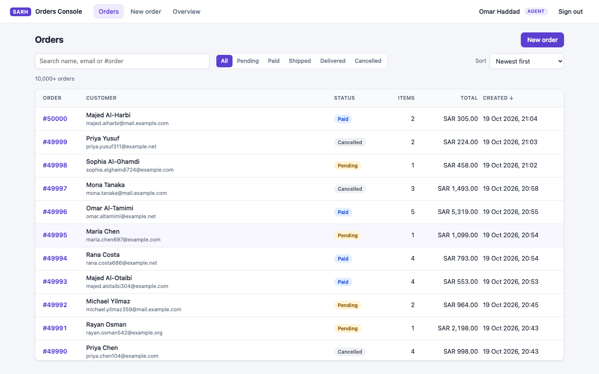
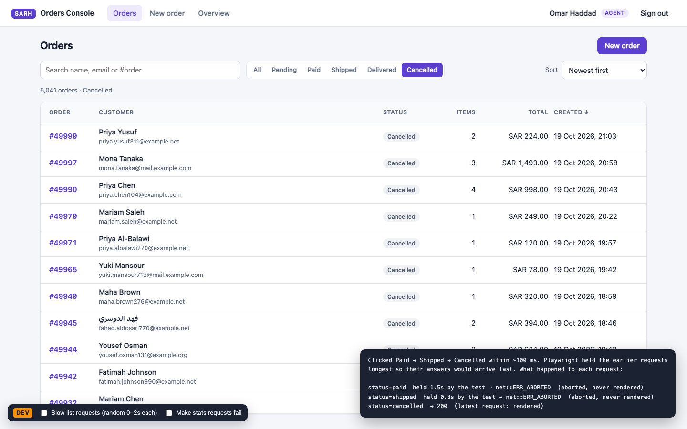
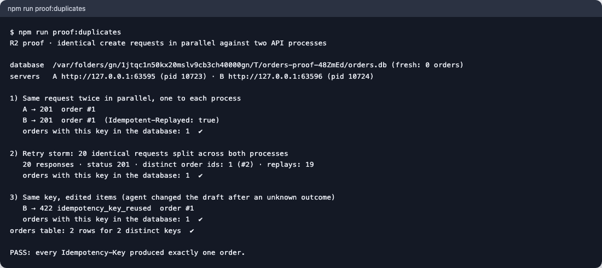

# Orders Console

[](https://github.com/Abdallahosama55/sarh-orders-console/actions/workflows/ci.yml)

A small slice of an operations console for the SARH full-stack take-home (v2, senior). Agents search 50,000 orders instantly, never see stale results, and register phone orders, where **one submission can never become two orders**. Stack: React 19, an Express 5 API and SQLite, all TypeScript.



**Demo video (84 s):** [`docs/demo/orders-console-demo.webm`](docs/demo/orders-console-demo.webm) shows the rapid-filter test, a double-click and a lost response on create, the duplicate proof, and the slow stats page cancelling and recovering. It is an automated recording of the real app (`npm run demo:record`), with captions explaining each step.

**Read next:** [DECISIONS.md](DECISIONS.md) · [SCALE.md](SCALE.md) · [QA report](docs/qa/QA-REPORT.md) · [Test plan](docs/qa/TEST-PLAN.md) · specs ([requirements](docs/specs/01-requirements.md) → [design](docs/specs/02-design.md) → [tasks](docs/specs/03-tasks.md))

## Run it

Requires Node 20.19+, 22.13+ or 24+ (`.nvmrc` pins 22). There is no database server, no Docker and nothing hosted.

```bash
npm install
npm run setup   # writes .env with a random JWT secret, seeds 50,000 orders (~2 s)
npm run dev     # API on :3001 and the app on http://localhost:5173
```

pnpm (10 or 11) also works: `pnpm install` instead of `npm install`. `pnpm-workspace.yaml` lists the workspaces and allows better-sqlite3's native build, which pnpm blocks by default. npm's `package-lock.json` remains the reference lockfile.

| Role  | Email              | Password     |
| ----- | ------------------ | ------------ |
| admin | `admin@sarh.test`  | `Admin#2026` |
| agent | `agent@sarh.test`  | `Agent#2026` |
| agent | `agent2@sarh.test` | `Agent#2026` |

| Command                    | What it does                                                                                                                                         |
| -------------------------- | ---------------------------------------------------------------------------------------------------------------------------------------------------- |
| `npm test`                 | 226 unit, integration and component tests (Vitest), about 7 s                                                                                        |
| `npm run proof:duplicates` | **R2 proof**: identical create requests in parallel against two API processes sharing one database; prints the row count read from the database file |
| `npm run test:e2e`         | 18 Playwright journeys in Chromium against a freshly seeded 50k database. First run: `npx playwright install chromium`                               |
| `npm run bench`            | p50/p95 of every list query shape at 50k rows, plus query plans                                                                                      |
| `npm run verify`           | typecheck + lint + format check + tests                                                                                                              |
| `npm run seed`             | resets the database to the deterministic seed                                                                                                        |
| `npm run screenshots`      | regenerates `docs/screenshots`                                                                                                                       |

## Check it by hand

**R1: the rapid-filter test.** On Orders, tick **Slow list requests** in the DEV bar (bottom left; present in development builds only). Every list request now takes a random 0–2 s, so answers arrive out of order. Click Paid → Shipped → Cancelled quickly. Only cancelled orders appear, the summary reads "· Cancelled", and DevTools → Network shows the superseded requests as _(canceled)_.



**R2: no duplicates.** Run `npm run proof:duplicates` (output below). In the UI, double-click **Create order**: one request, one order. For the harder cases, the E2E suite also drops the response after the server has created the order and checks that the retry shows that same order, and reloads mid-submit.



**O1: slow stats.** Open Overview: the page renders at once, with an elapsed-seconds counter, and stays usable. Leave within 3 s and the request is cancelled; the API logs `stats report skipped`. Tick **Make stats requests fail** in the DEV bar to see the error state and its single Retry.

## How it works

- **List (R1).** The URL holds the filters (`?q=&status=&sort=&dir=`). Each combination is its own React Query key, and the query's `AbortSignal` reaches `fetch`. A superseded request is cancelled, and a late answer can only land in its own cache entry, which nothing renders. The server pages with a keyset cursor `(sort value, id)`. TanStack Virtual keeps about 40 rows in the DOM however many pages are loaded.
- **Create (R2).** The idempotency key belongs to the draft and is persisted with it. The server runs `INSERT … ON CONFLICT DO NOTHING` against `UNIQUE (created_by, idempotency_key)` inside one transaction. Same body: replay. Different body: `422`. Details and limits are in [DECISIONS.md](DECISIONS.md#1--r2-the-database-decides-what-the-same-order-is).
- **Search.** `#123` looks up the order number. Three or more characters use an FTS5 **trigram** index, SQLite's `pg_trgm`. One or two characters fall back to an escaped `LIKE` scan that stops at the page limit.
- **Why SQLite.** The brief requires a real database that runs in under five minutes with no services. Every guarantee used here (unique index, transactions, `ON CONFLICT`, row-value keyset, trigram search) has a direct PostgreSQL equivalent; [SCALE.md](SCALE.md) covers the move.

**Indexes:**

| Index                                                | Serves                                            |
| ---------------------------------------------------- | ------------------------------------------------- |
| `orders_created_idx (created_at, id)`                | All orders by date; the "revenue today" range     |
| `orders_total_idx (total_cents, id)`                 | All orders by amount                              |
| `orders_status_created_idx (status, created_at, id)` | Status filter + date sort                         |
| `orders_status_total_idx (status, total_cents, id)`  | Status filter + amount sort                       |
| `orders_search` (FTS5, trigram)                      | Substring search on name and email, 3+ characters |
| `order_items_order_idx (order_id)`                   | Item counts, order detail                         |
| `UNIQUE (created_by, idempotency_key)`               | R2                                                |

An automated test runs `EXPLAIN QUERY PLAN` on every filter × sort × cursor combination and fails if one needs a sort step. Measured at 50k rows: about 0.06 ms per page at any depth; the worst search (a term matching every row) has a p95 of 18 ms. Full table in the [QA report](docs/qa/QA-REPORT.md#5-performance).

## Code review: the inherited auth middleware

Every row is fixed and covered by a test in `apps/api/test/auth.test.ts` unless noted.

| #   | Problem in the inherited code                                              | Why it matters                                                                                                                             | What changed                                                                                                                                                        |
| --- | -------------------------------------------------------------------------- | ------------------------------------------------------------------------------------------------------------------------------------------ | ------------------------------------------------------------------------------------------------------------------------------------------------------------------- |
| 1   | `jwt.decode(token)`: the signature is never checked                        | Anyone can hand-write `{"sub":1,"role":"admin"}` and be admin. A full auth bypass.                                                         | `jwt.verify` with `algorithms: ['HS256']` (blocks `alg: none` and algorithm confusion), issuer, audience and expiry. `auth/session-token.ts`                        |
| 2   | Hard-coded `SECRET = "sarh-secret-2026"`                                   | Committed to git, identical in every environment, and guessable offline from any issued token                                              | `JWT_SECRET` from the environment, at least 32 characters, startup fails otherwise. `npm run setup` generates 48 random bytes. `config.ts` (test: `config.test.ts`) |
| 3   | Admin check "done in the React AdminOnly component"                        | Hiding a button is not authorisation: any agent can `curl -X DELETE`                                                                       | `requireRole('admin')` on the route. `AdminOnly` stays as UX only.                                                                                                  |
| 4   | Plaintext passwords, compared inside the query                             | A database leak exposes every password, and salted hashing is impossible this way                                                          | scrypt (N=2¹⁵, r=8, p=1, 16-byte salt) with `timingSafeEqual`. Unknown emails are checked against a dummy hash, so timing doesn't reveal which accounts exist.      |
| 5   | `req.body.email` and `req.body.password` go straight into the ORM `where`  | Operator injection: with Prisma-style APIs, `{"email":{"not":""},"password":{"not":""}}` matches the first user. Login without a password. | A strict zod schema with string types before any query (`400` otherwise)                                                                                            |
| 6   | Token also accepted from `?token=`                                         | Query strings end up in server and proxy logs, browser history and `Referer` headers                                                       | The session lives only in an `httpOnly` cookie. `?token=` and `Authorization` headers are ignored.                                                                  |
| 7   | Tokens never expire (`jwt.sign` without `expiresIn`) and cannot be revoked | A leaked token is valid forever                                                                                                            | 8-hour expiry, plus `token_version`: logout increments it and revokes every copy of the token                                                                       |
| 8   | `req.user = payload`: role and claims trusted from the token               | A demoted user keeps admin rights; arbitrary claims reach handlers                                                                         | The user and role are re-read from the database on every request. The token carries only `sub` and `ver`.                                                           |
| 9   | No brute-force protection on `/login`                                      | Unlimited password guessing                                                                                                                | 10 failures per 15 minutes per IP + email. IP alone would lock out a whole office behind one address.                                                               |
| 10  | Async handler with no error handling; `req.params.id` used unchecked       | In Express 4 a rejected promise (unknown or malformed id) hangs the request or crashes the process                                         | Express 5 forwards rejections to one error handler. Unknown ids get `404`, malformed ones `400`, and no stack traces leak.                                          |
| 11  | Hard delete of a financial record, with no trace                           | Accounting and dispute history disappear                                                                                                   | Soft delete records `deleted_by` and `deleted_at`. A late retry of a deleted order's key gets `409` and is never recreated.                                         |
| 12  | `split(" ")[1]` with no scheme check; untyped `req`/`res`                  | Any `Authorization` header shape is treated as a token; `req.user` has no type                                                             | Removed together with header auth. `Express.Request.user` is typed and only set from the database.                                                                  |
| 13  | (introduced by fixing 6) Cookies make CSRF possible                        | Another site could ride the cookie                                                                                                         | `SameSite=Strict`, plus an `Origin` allow-list on state-changing requests, which also blocks sibling subdomains that `SameSite` cannot                              |

**Where the token lives.** The JWT is in an `httpOnly`, `SameSite=Strict` cookie scoped to `/api` (and `Secure` in production), so page JavaScript can never read it. That stops an XSS bug from stealing the token and the URL and log leaks that `?token=` allowed. It does not stop script injected into an open tab from making requests as the agent; React's escaping and a CSP are the defence there. The trade-off is CSRF exposure, which `SameSite=Strict` plus an `Origin` check on writes closes.

## Product question: "Delete all cancelled orders"

- **Ask first:** what is the button for: clutter in the list, slow reports, storage, or a customer asking to be forgotten?
- Which cancelled orders: all of them, or only those older than N months? Who presses it, and how often?
- Do finance, refunds, chargebacks or tax still need them? An order cancelled after payment is a refund trail.
- **If she can't answer:** don't ship an irreversible bulk delete. Hide cancelled orders from the default view, one click away from showing them.
- If storage or privacy is the real need, propose a retention job that anonymises old cancelled orders, with an audit log and an agreed owner.

## Assumptions

The brief leaves these open; the full list is in [requirements §3](docs/specs/01-requirements.md#3-assumptions).

- One currency (SAR), stored as integer halalas.
- The order amount is derived from its items; the server computes it and never trusts a client total.
- New orders start as `pending`.
- "Revenue today" = paid, shipped or delivered orders created since midnight `Asia/Riyadh`.
- O1's "one retry" = a visible error with a single Retry action, and no silent automatic retries that would double a 3–6 s wait.
- Delete is a soft delete.
- Search also accepts order numbers (`#123`).

## What I skipped and why

- **O2, optimistic create.** The brief allows at most one optional task; O1 was chosen. Optimistic rows also sit awkwardly with a server-sorted, filtered, keyset list: where does a new order go when it doesn't match the current filter?
- **Business-level duplicate detection** (two separate drafts of the same real-world order). The idempotency key covers retries of one submission. "Same order" for two drafts is a product rule that needs the operations lead (open question Q-2); a soft "possible duplicate" warning is the proposal.
- **Status changes, user management, password reset, refresh tokens, MFA.** Not asked for. Sessions last one 8-hour shift and can be revoked.
- **Deployment, HTTPS, CSP headers on served HTML.** Dev runs on Vite; `helmet` covers API responses. The cookie is `Secure` in production.
- **Full Arabic / RTL interface.** The data supports Arabic (search, `<bdi>` isolation, Arabic-Indic digits in prices), but the UI is English.

## Notes for reviewers

- **No `<StrictMode>`, deliberately.** Its development-only double mount makes React Query abort and re-issue every query's first request. That would put phantom cancellations in the network panel and the API log, exactly where the rapid-filter and cancel-on-leave behaviour is checked. Lint runs the React Compiler rule set instead.
- **The DEV bar** only adds request headers (`X-Debug-Latency`, `X-Debug-Fail`). The API ignores them when `NODE_ENV=production`, and the bar is absent from production builds.
- **If a port is busy,** the dev servers stop rather than drift to another port, because the API's CSRF check only accepts the configured origin. Change `PORT` / `APP_ORIGIN` in `.env`.

## Project layout

```
apps/api       Express 5 API: auth/, orders/ (repository SQL, idempotent create, stats), db/ (migrations, seed), proof/, scripts/
apps/web       React 19 app: orders/ (URL filters, virtual table, drawer), create-order/ (draft + key), stats/, auth/
packages/shared  zod contracts and money helpers used by both sides
e2e            Playwright journeys and the screenshot generator
docs           specs/ (requirements → design → tasks), qa/ (test plan, QA report), screenshots/
```
