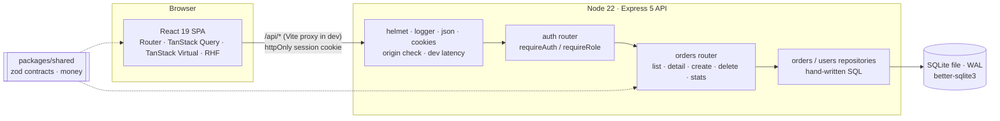

# 02 · Design — Orders Console

This design implements [`01-requirements.md`](01-requirements.md). Section numbers are referenced from [`03-tasks.md`](03-tasks.md) and from code comments where a choice is non-obvious.

## 1. Architecture



- **One repo, npm workspaces**: `apps/api`, `apps/web` and `packages/shared`. The shared package holds the zod schemas that **both** sides validate with (R2-2) and the money helpers, so the client total and server total cannot diverge.
- **SQLite** because the brief requires a real database that runs locally in under five minutes with no services (NFR-1). Every guarantee this design relies on (unique constraints, transactions, `ON CONFLICT`, row-value keyset comparisons, trigram search) has a direct PostgreSQL equivalent. `SCALE.md` covers the move.
- **Hand-written SQL in repositories** (no ORM). Query design and indexes are graded, so the SQL should be visible and reviewable in one place.

## 2. Repository layout

```
apps/api/src
  app.ts                  createApp(deps): middleware + routers (no listen; used by tests)
  server.ts               load env → config → open DB → migrate → listen
  config.ts               zod-validated environment (fails fast)
  db/                     connection, migrations/*.sql (PRAGMA user_version)
  http/                   errors, origin check, dev latency, request logger, validation
  auth/                   router, middleware, password (scrypt), session token (JWT), rate limit, users repo
  orders/                 router, repository (SQL), list cursor, create-order (idempotency), stats
  scripts/                setup, seed, prove-no-duplicates, bench
apps/web/src
  app/                    router, query client, layout, dev toolbar
  lib/                    api client, formatting, small hooks
  auth/                   session query, login page, RequireAuth, AdminOnly
  orders/                 filters ⇄ URL, list query, toolbar, virtual table, detail drawer
  create-order/           form schema, draft persistence, create mutation, page
  stats/                  stats query, page
packages/shared/src       orders + auth contracts (zod), money, api error types
e2e/                      Playwright journeys (real API + real browser)
```

## 3. Data model

```sql
CREATE TABLE users (
  id            INTEGER PRIMARY KEY,
  email         TEXT    NOT NULL UNIQUE,              -- stored lower-cased
  name          TEXT    NOT NULL,
  role          TEXT    NOT NULL CHECK (role IN ('admin', 'agent')),
  password_hash TEXT    NOT NULL,                     -- scrypt$N$r$p$salt$hash
  token_version INTEGER NOT NULL DEFAULT 0,           -- bump = revoke all sessions (SEC-4)
  created_at    INTEGER NOT NULL
) STRICT;

CREATE TABLE orders (
  id                  INTEGER PRIMARY KEY,
  customer_name       TEXT    NOT NULL,
  customer_email      TEXT    NOT NULL,
  status              TEXT    NOT NULL CHECK (status IN ('pending','paid','shipped','delivered','cancelled')),
  total_cents         INTEGER NOT NULL CHECK (total_cents >= 0),
  created_at          INTEGER NOT NULL,               -- epoch ms, UTC
  created_by          INTEGER REFERENCES users (id),  -- NULL = imported (A-4)
  idempotency_key     TEXT,
  request_fingerprint TEXT,                           -- sha256 of the normalised request body
  deleted_at          INTEGER,
  deleted_by          INTEGER REFERENCES users (id),
  UNIQUE (created_by, idempotency_key),               -- ← the R2 guarantee
  CHECK ((created_by IS NULL AND idempotency_key IS NULL AND request_fingerprint IS NULL)
      OR (created_by IS NOT NULL AND idempotency_key IS NOT NULL AND request_fingerprint IS NOT NULL))
) STRICT;

CREATE TABLE order_items (
  id               INTEGER PRIMARY KEY,
  order_id         INTEGER NOT NULL REFERENCES orders (id),
  product_name     TEXT    NOT NULL,
  quantity         INTEGER NOT NULL CHECK (quantity > 0),
  unit_price_cents INTEGER NOT NULL CHECK (unit_price_cents > 0)
) STRICT;
```

The `CHECK` makes it impossible for an API-created order to exist **without** a key. That matters because SQLite, like PostgreSQL, treats `NULL`s as distinct in a `UNIQUE` constraint, so a missing key would silently escape the guarantee.

### 3.1 Indexes (R1-7)

| Index                                                                        | Serves                                                                               |
| ---------------------------------------------------------------------------- | ------------------------------------------------------------------------------------ |
| `orders_created_idx (created_at, id)`                                        | All statuses, sort by date (either direction); "revenue today" range scan            |
| `orders_total_idx (total_cents, id)`                                         | All statuses, sort by amount                                                         |
| `orders_status_created_idx (status, created_at, id)`                         | Status filter + sort by date                                                         |
| `orders_status_total_idx (status, total_cents, id)`                          | Status filter + sort by amount; covers the stats `GROUP BY status`                   |
| `orders_search` — FTS5 virtual table, `tokenize='trigram'` over name + email | Substring search ≥ 3 characters (the B-tree indexes above cannot serve `LIKE '%x%'`) |
| `order_items_order_idx (order_id)`                                           | Item count per row, order detail                                                     |
| `UNIQUE (created_by, idempotency_key)` (automatic index)                     | Idempotent create                                                                    |

The trailing `id` in each composite index matches the tie-breaker in `ORDER BY …, id`, so keyset pagination is a single index range seek. Triggers keep `orders_search` in sync on insert, update and delete. `ANALYZE` runs after seeding so the planner has statistics.

## 4. API contract

All routes are under `/api`. Errors always have the shape `{ "error": { "code": string, "message": string, "details"?: unknown } }`.

| Method & path        | Auth              | Purpose                                                                         | Success                                                     | Notable errors                                                                                                              |
| -------------------- | ----------------- | ------------------------------------------------------------------------------- | ----------------------------------------------------------- | --------------------------------------------------------------------------------------------------------------------------- |
| `POST /auth/login`   | –                 | Verify credentials, set session cookie                                          | `200 { user }`                                              | 400 validation, 401 `invalid_credentials`, 429 `rate_limited`                                                               |
| `POST /auth/logout`  | cookie (optional) | Revoke sessions (`token_version++`), clear cookie                               | `204`                                                       | –                                                                                                                           |
| `GET /auth/me`       | ✔                 | Current user from the DB                                                        | `200 { user }`                                              | 401                                                                                                                         |
| `GET /orders`        | ✔                 | List page: `q, status, sort=createdAt\|total, dir=asc\|desc, limit≤100, cursor` | `200 { items, nextCursor, total }`                          | 400 `validation_failed` / `invalid_cursor`                                                                                  |
| `GET /orders/stats`  | ✔                 | O1 report after 3–6 s                                                           | `200 { byStatus, revenueToday, generatedAt }`               | 503 (simulated in dev)                                                                                                      |
| `GET /orders/:id`    | ✔                 | Detail with items                                                               | `200 OrderDetail`                                           | 400, 404                                                                                                                    |
| `POST /orders`       | ✔                 | Create. Header `Idempotency-Key: <uuid>` is **required**                        | `201 OrderDetail` (+ `Idempotent-Replayed: true` on replay) | 400 `idempotency_key_missing` / `validation_failed`, 409 `order_deleted`, 422 `idempotency_key_reused`, 503 `database_busy` |
| `DELETE /orders/:id` | ✔ admin           | Soft delete                                                                     | `204`                                                       | 400, 403 `forbidden`, 404                                                                                                   |
| `GET /health`        | –                 | Readiness probe for scripts and E2E                                             | `200 { ok: true }`                                          | –                                                                                                                           |

`total` (on the first page only) is `{ count, capped }`. Counting stops at 10,001 rows, so the cost of a count is bounded no matter how large the table grows (R1-10).

## 5. R1 design — fast and correct list

### 5.1 Query (server)

```sql
SELECT o.id, o.customer_name, o.customer_email, o.status, o.total_cents, o.created_at,
       (SELECT COUNT(*) FROM order_items i WHERE i.order_id = o.id) AS item_count
FROM orders o
WHERE o.deleted_at IS NULL
  [AND o.status = @status]
  [AND <search predicate>]
  [AND (o.<sort_col>, o.id) < (@cursorValue, @cursorId)]      -- '>' when ascending
ORDER BY o.<sort_col> DESC, o.id DESC                          -- ASC when ascending
LIMIT @limit + 1                                               -- +1 tells us if there is a next page
```

- The sort column comes from a whitelist map (`createdAt → created_at`, `total → total_cents`). User input never reaches the SQL text.
- **Keyset cursor** = base64url of `[sort, dir, value, id]`. A cursor whose sort or direction differs from the request is rejected (`400 invalid_cursor`). Keyset paging is O(log n) at any depth and stable while agents insert new orders. OFFSET is neither (see DECISIONS.md).
- **Search predicate**, chosen by input shape:
  - `#123` / `123` → `o.id = @orderNumber` (A-8)
  - ≥ 3 characters → `o.id IN (SELECT rowid FROM orders_search WHERE orders_search MATCH @phrase)`, with the input quoted as an FTS5 string (`"` doubled)
  - 1–2 characters → `customer_name LIKE @like ESCAPE '\' OR customer_email LIKE …`, with `%` and `_` escaped. The trigram index cannot serve fewer than three characters. This scan is bounded because it stops at `LIMIT`.

### 5.2 Client data flow and the latest-wins guarantee (R1-8)

```
URL ?q&status&sort&dir ──parse (zod, defaults)──▶ filters
filters (q debounced 300 ms) ──▶ queryKey ['orders','list',filters]
useInfiniteQuery(queryKey, ({ pageParam, signal }) => GET /api/orders …)
```

There are two independent layers of protection:

1. **Results are stored per query key.** A response can only be written into the cache entry of the key that requested it, and the table renders the entry for the _current_ key. A slow response for `status=paid` that lands after the user picked `cancelled` updates the `paid` entry, which nothing is rendering. No sequence numbers or "ignore if stale" flags can be forgotten, because there is nothing to compare.
2. **Superseded requests are cancelled.** The query function passes TanStack Query's `AbortSignal` to `fetch`. When a key loses its last observer, the request is aborted: it shows as cancelled in the network panel, and the server stops any dev latency wait.

There is deliberately no `placeholderData: keepPreviousData`. While a new key loads, the table shows skeleton rows instead of the previous filter's rows, so the screen never shows rows that do not match the visible filters. The table is re-mounted per filter key, which also resets the scroll position.

### 5.3 Rendering (R1-6)

`@tanstack/react-virtual` uses fixed 56 px rows and overscan 12. The header sits inside the scroll container (`position: sticky`) with `scrollMargin`, so columns always align. When the last rendered index comes within 15 rows of the loaded count, `fetchNextPage()` runs. A failed next-page fetch shows an inline Retry row instead of looping. Rows use `role="row"` / `cell` with `aria-rowindex`. The order number is a real link for keyboard users, and a click anywhere on the row is a mouse shortcut.

## 6. R2 design — no duplicates, ever

### 6.1 Server: one transaction, one constraint

```mermaid
sequenceDiagram
  participant C as Client (draft key K)
  participant A as API process A
  participant B as API process B
  participant D as SQLite (UNIQUE created_by, idempotency_key)
  C->>A: POST /orders  Idempotency-Key: K
  C->>B: POST /orders  Idempotency-Key: K (retry / double click)
  A->>D: BEGIN IMMEDIATE (takes write lock)
  B->>D: BEGIN IMMEDIATE (waits on lock, busy_timeout 5 s)
  A->>D: INSERT … ON CONFLICT(created_by, idempotency_key) DO NOTHING RETURNING id → 51234
  A->>D: INSERT order_items …; COMMIT
  D-->>B: lock granted
  B->>D: INSERT … ON CONFLICT DO NOTHING RETURNING id → (no row)
  B->>D: SELECT id, request_fingerprint WHERE created_by=? AND idempotency_key=K
  B->>D: COMMIT
  A-->>C: 201 order 51234
  B-->>C: 201 order 51234 · Idempotent-Replayed: true
```

- The request is validated **before** the transaction, so a `400` never consumes the key (R2-7).
- `request_fingerprint` = SHA-256 of the normalised, validated body. Same key with the same fingerprint → replay (R2-5). Same key with a different fingerprint → `422` with the existing order id (R2-6).
- Keys are scoped per user: one agent's key can never replay or collide with another agent's order.
- The guarantee comes from the **unique index**, not from application code or the event loop. With a synchronous driver, two requests inside _one_ Node process cannot interleave inside the transaction, so a naive check-then-insert would also pass a single-process test. The proof script therefore runs **two OS processes** against the same database file.
- Replay of an order that an admin has since deleted → `409 order_deleted`, never a re-creation.
- `SQLITE_BUSY` after the 5 s busy timeout → `503 database_busy`. This is safe to retry with the same key.

### 6.2 Client: the key belongs to the draft

| Situation                                                   | What happens                                                                                                                |
| ----------------------------------------------------------- | --------------------------------------------------------------------------------------------------------------------------- |
| Double-click                                                | A synchronous in-flight guard plus a disabled button means one request. Even if two were sent, they share K.                |
| Network error, 10 s timeout, 502/503/504                    | Automatic retry (2×, exponential back-off) with **the same K**. The server replays if the first attempt actually succeeded. |
| Retries exhausted                                           | Banner: "We couldn't confirm whether the order was created. Trying again is safe." Try again → same K.                      |
| Page reload mid-submit                                      | The draft (values + K) is persisted in `sessionStorage`, so the reload restores K.                                          |
| Agent edits the form after an unknown outcome and resubmits | Same K, different fingerprint → 422 → "already submitted as #X", with links to view it or start a new order.                |
| Session expired (401)                                       | Redirect to login with `next=/orders/new`. The draft survives and is restored after login.                                  |
| Confirmed success                                           | The draft is cleared. "Create another order" mints a new K.                                                                 |

### 6.3 Known limits (repeated in DECISIONS.md)

- Two **separate drafts** for the same real-world order (two agents, or one agent re-typing) have different keys and are not caught. That is a business rule (Q-2), not a transport problem.
- Clearing site data mid-submit, or opening a second tab, creates a new draft and a new key.
- Keys live on the order row. An admin deleting an order does not free its key (replay → 409).

## 7. SEC design — what changed from the inherited middleware

| Finding in the inherited code                                       | Fix (where)                                                                                                  |
| ------------------------------------------------------------------- | ------------------------------------------------------------------------------------------------------------ |
| `jwt.decode` (no signature check)                                   | `jwt.verify` with `algorithms: ['HS256']`, issuer, audience, expiry (`auth/session-token.ts`)                |
| Hard-coded, guessable secret                                        | `JWT_SECRET` from env, ≥ 32 chars, fail-fast; generated by `npm run setup` (`config.ts`, `scripts/setup.ts`) |
| Token accepted from `?token=`                                       | Cookie only (`httpOnly`, `SameSite=Strict`, `Path=/api`, `Secure` in production)                             |
| No expiry on issued tokens                                          | 8 h `exp` + `token_version` revocation                                                                       |
| Role trusted from token / UI-only admin check                       | User + role re-read from the DB on every request; `requireRole('admin')` on delete                           |
| Plaintext password compared in the query                            | scrypt (N=2¹⁵, r=8, p=1, 16-byte salt), `timingSafeEqual`, dummy hash for unknown emails                     |
| `req.body` passed straight into the query                           | zod `strictObject` with string types → no operator injection                                                 |
| No brute-force protection                                           | `express-rate-limit`: 10 failures / 15 min per IP + email                                                    |
| Async handler without error handling; hard delete of financial data | Express 5 central error handler (400/404/500, no stack traces); soft delete with `deleted_by`                |
| Cookies introduce CSRF risk                                         | `SameSite=Strict` + `Origin` allow-list on unsafe methods (covers same-site sibling sub-domains too)         |

## 8. O1 design — slow stats

- Server: wait a random 3–6 s (`STATS_DELAY_MS`) using `timers/promises.setTimeout` with an `AbortSignal` tied to `res.on('close')`. If the client disconnects, the handler logs `stats report skipped` and **never runs the queries**. Then it runs two aggregate queries: `GROUP BY status`, and a revenue range scan from local midnight in `Asia/Riyadh` via `orders_created_idx`.
- Client: `useQuery` with `retry: false` (A-6), `staleTime: 60 s` and the query's `signal` passed to `fetch`. When the page unmounts, TanStack Query aborts the in-flight request. The page shows skeleton cards, an elapsed-seconds counter, and a note that leaving cancels the request. The error panel has one **Retry** button that calls `refetch()` and is disabled while that request runs.

## 9. Cross-cutting

- **Errors:** `HttpError(status, code, message, details)` is thrown anywhere and serialised in one place. zod issues are flattened to `{ fields: { "items.0.quantity": "…" } }`, and the form maps them back onto its inputs.
- **Logging:** one line per request (method, path, status, ms, or "client aborted"). The `q` parameter is redacted because search terms are customer PII. Tokens and passwords are never logged.
- **Dev-only simulation:** when `NODE_ENV !== 'production'`, `X-Debug-Latency: <ms>` adds a random 0–ms delay, and `X-Debug-Fail: 1` fails the stats report. A DEV toolbar in the UI (absent from production builds) toggles both, so reviewers can watch the rapid-filter test and the error state by hand.
- **Config:** zod-validated environment, `.env` at the repo root, and `.env.example` committed.

## 10. Testing strategy

The full plan and traceability matrix are in [`../qa/TEST-PLAN.md`](../qa/TEST-PLAN.md).

| Level           | Tool                                                     | Focus                                                                                                                 |
| --------------- | -------------------------------------------------------- | --------------------------------------------------------------------------------------------------------------------- |
| Unit            | Vitest                                                   | money, cursor codec, time-zone boundaries, password hashing, fingerprinting                                           |
| API integration | Vitest + Supertest + real SQLite file per suite          | auth findings, list correctness (exhaustive paging), query plans, idempotency under parallel load, stats cancellation |
| Component       | Vitest + Testing Library + MSW                           | latest-wins with out-of-order responses, form validation and retries, stats error/retry/abort                         |
| End-to-end      | Playwright (Chromium) against the real API with 50k rows | rapid filter, double-click and lost-response create, stats cancel-on-navigate, admin vs agent                         |
| Proof           | `npm run proof:duplicates`                               | R2 across two server processes                                                                                        |
| Performance     | `npm run bench`                                          | p50/p95 per query shape plus `EXPLAIN QUERY PLAN`                                                                     |

## 11. Risks

| Risk                                                                | Mitigation                                                                                               |
| ------------------------------------------------------------------- | -------------------------------------------------------------------------------------------------------- |
| Planner picks a temp B-tree sort for some combination               | Automated plan assertions (R1-7) and `ANALYZE` after seeding                                             |
| Trigram search slow for very common terms                           | Benchmarked. The 1–2 character fallback is bounded by `LIMIT`. At 5M rows: `pg_trgm` (SCALE.md).         |
| `better-sqlite3` native binary missing on a reviewer's Node version | Supports Node 20–26 with prebuilt binaries. `engines` and `.nvmrc` pin a supported version.              |
| Reviewers cannot observe a race on a fast local machine             | DEV toolbar latency toggle, plus deterministic component and E2E tests that force out-of-order responses |
